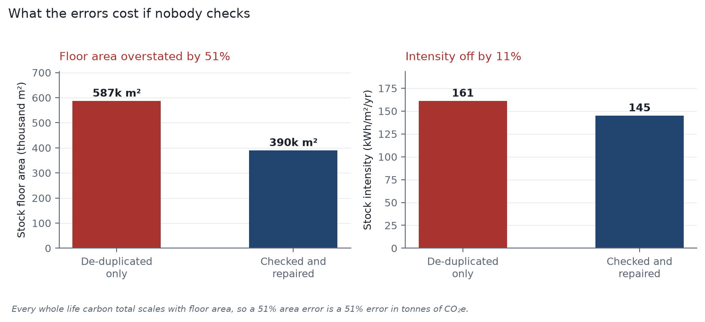
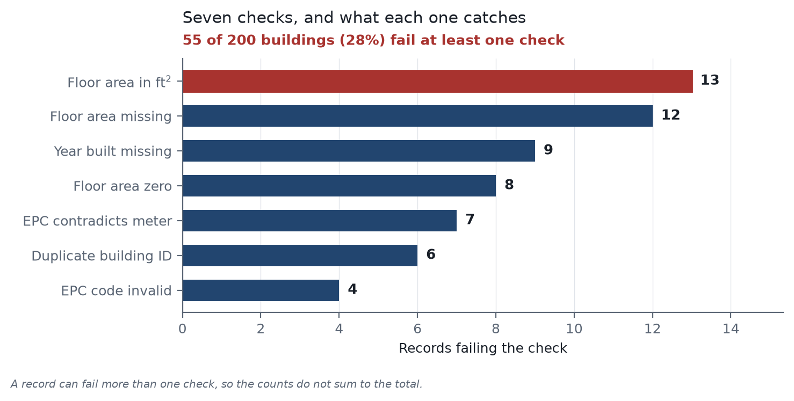
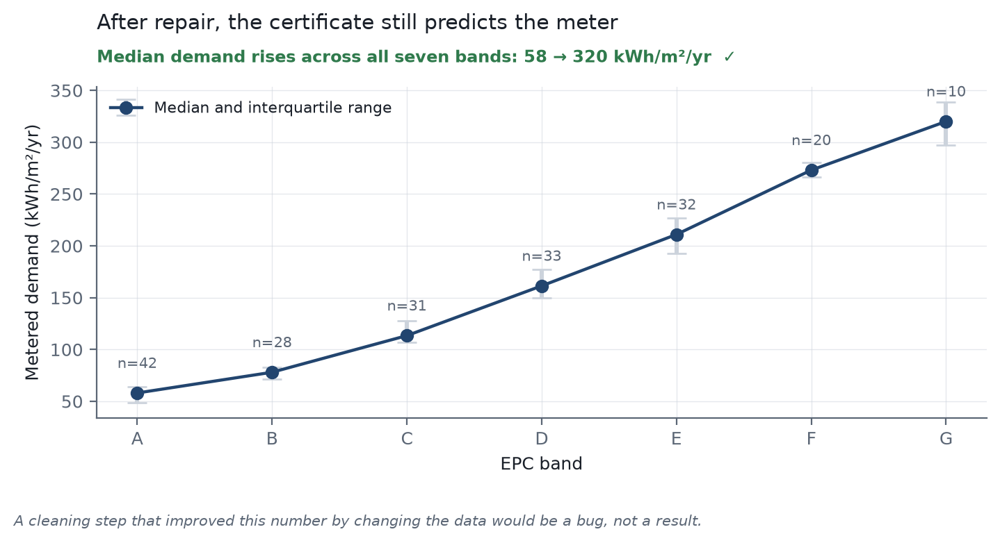

# Seven checks before you trust a building register

A small data-quality project for whole life carbon benchmarking, written in Python (pandas, numpy, matplotlib).

**Note:** the building register used here is synthetic. I generated it myself, with known errors added on purpose, so I could check whether my checks work. The numbers below show how the method behaves. They are not findings about real buildings.

---

## What this is about

A carbon benchmark is a ratio: kgCO₂e per m² of floor area.

Most of the work goes into the carbon number (materials, EPDs, life cycle modules). The floor area usually comes from a national building register, which is filled in by many different people and systems. If the floor area is wrong, the benchmark is wrong, even when the carbon calculation is perfect.

I wanted to see how big that effect can get. So I made a small register of 200 buildings, added common errors to it, wrote seven checks to find them, repaired what could be repaired, and compared the result with a version where only duplicates were removed.

---

## Result

| | Duplicates removed only | Checked and repaired | Difference |
|---|---|---|---|
| Total floor area | 586,806 m² | 389,581 m² | +50.6% |
| Average energy intensity | 161.1 kWh/m²/yr | 145.0 kWh/m²/yr | +11.1% |

Removing duplicate rows is the first thing most people do. In this register, doing only that leaves the total floor area about 50% too high. Any carbon total that is calculated from floor area would be about 50% too high as well.

This is a result of the errors I put in (for example, 14 values in square feet, which is a lot for 200 rows). A real register will behave differently.



---

## What the checks found



55 of the 200 buildings (28%) fail at least one check.

| Check | Records caught | Why it matters |
|---|---|---|
| Floor area in ft² instead of m² | 13 | Area is about 10.8 times too large, so intensity is about 10.8 times too small |
| Floor area missing | 12 | There is no floor area to divide by |
| Year built missing | 9 | The building cannot be used in an analysis by age |
| Floor area is zero | 8 | A missing value was stored as a number |
| EPC label contradicts metered energy | 7 | The label and the meter cannot both be right |
| Duplicate building ID | 6 | The same building is counted twice |
| EPC code is invalid | 4 | One band gets split into several when grouping |

---

## The seven checks, in plain words

I tried to base every check on something physical or on how registers actually get filled in, rather than on a statistical cut-off.

**1. Floor area in square feet**
A simple approach is to flag the largest 1% of floor areas. That would flag real large buildings and would miss medium-sized buildings that were entered in square feet. Instead I use floor area per storey. Each building type has a ceiling (for example, 200 m² per storey for a single-family house). If a record is above the ceiling, I divide it by 10.7639. If that brings it below the ceiling, it was in square feet and gets converted. If it does not, the building is just very large and I leave it alone.
In this register it flagged 13 records and all 13 were square feet. I should be clear that this is partly built in: I wrote both the errors and the check, so a perfect score is expected. It would not look like this on real data.

**2. EPC label against metered energy**
Each EPC band implies a range of energy use. An A-rated building that uses 350 kWh/m²/yr does not fit that range. This catches records where the two fields contradict each other, for example after a retrofit that was added to the certificate but not to the meter data. It found 7 records.

**3. Zero floor area**
Zero is not a small building, it is an unknown. I set it to empty instead of replacing it with a minimum value, so no number is invented.

**4. Duplicate IDs**
`drop_duplicates(keep="first")` keeps whichever row comes first, which might be the one with a blank floor area. I keep the row with the most fields filled in.

**5. Inconsistent labels**
`MFH`, `mfh` and ` Mfh ` are the same building type. If they are not cleaned first, a group-by shows 11 types instead of 4.

**6. Filling in missing floor area**
For each group of building type and country, I take the median floor area per storey and multiply it by the building's own number of storeys. This way a 3-storey and a 1-storey house do not get the same value. I use the median because floor areas are skewed towards a few very large buildings. Every filled-in value is marked in a `gfa_imputed` column, so results can be re-run without them.

**7. Order of the repair steps**
The order is: remove duplicates, clean labels, convert units, set impossible values to empty, fill in missing values. If the order is wrong, nothing crashes, but the numbers are quietly wrong. For example, filling in values before removing zeros uses the zeros as real data.

---

## Did the repair damage the data?



I built the register so that a better EPC band means lower metered energy use, as it should. After the repair, the median energy use still rises across all seven bands, from 58 to 320 kWh/m²/yr. This shows the cleaning steps did not break that relationship.

---

## How to run it

```bash
git clone https://github.com/jenn91021-art/wlc-data-check
cd wlc-data-check
pip install -r requirements.txt

python make_sample.py     # generate the register (it is also committed)
python run_checks.py      # data-quality report
python repair.py          # repair the data and show the effect
python figures.py         # make the three figures
python -m pytest -q       # run the 10 tests
```

## Files

```
make_sample.py            generates a 200-building register with known errors
checks.py                 the seven checks, one function each
run_checks.py             runs all checks and writes the report
repair.py                 the five repair steps, in order
figures.py                the three figures
test_checks.py            10 tests
requirements.txt
sample_buildings.csv      messy input (206 rows)
buildings_clean.csv       repaired register (200 rows)
data_quality_report.csv   one row per check, with counts and severity
flagged_records.csv       every failing record with its reason
figures/                  the three PNGs
```

---

## Limits

- **No carbon is calculated.** This only deals with the floor area side of the ratio.
- **The data is synthetic.** It has 200 buildings from Austria, Hungary and Italy. Real registers have more problems than these, such as wrong geometry, changed addresses and the same building listed under two IDs.
- **The ceilings are my own assumptions.** 200 m² per storey for a house is a generous limit. A register with warehouses or car parks would need different ceilings.
- **It is small.** 206 rows is enough to test the logic but not to say anything about performance on large datasets.
- **Seven checks is not a full audit.** I picked the ones that matter most for a benchmark.

## Next steps

- Run the same checks on a real open EPC dataset.
- Add checks that compare footprint with geometry data.
- Detect duplicates that have different IDs.
